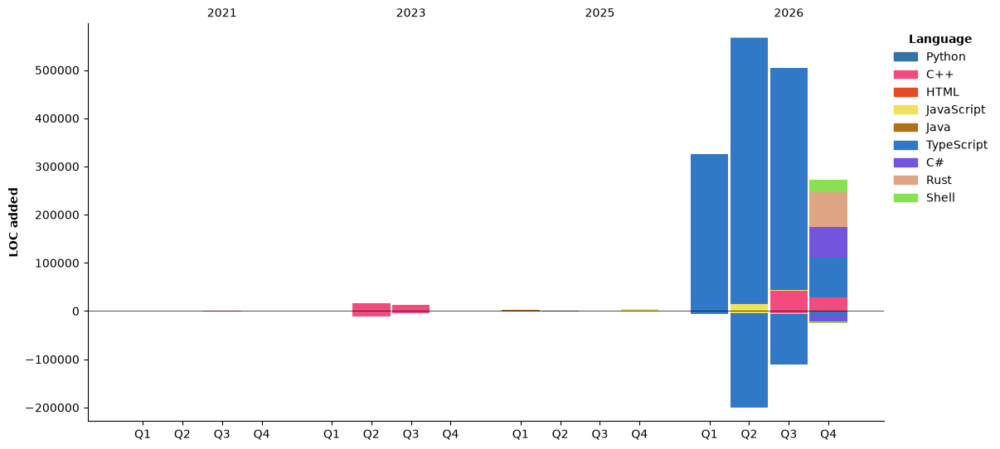

<div align="center">

[](https://git.io/typing-svg)

---

<p>Full-stack developer working on desktop software, self-hosted services, and developer tools.</p>

<p>
  <a href="https://github.com/cloudwhile">
    
  </a>
  <a href="https://cloudwhile.github.io">
    
  </a>
  <a href="mailto:cloudwhile@icetowne.com">
    
  </a>
</p>

</div>

## About me

- Building desktop applications that make system-level work easier to manage.
- Exploring self-hosted services and practical cloud-drive infrastructure.
- Creating reusable C/C++ libraries and modern web development tooling.
- Open to issues, ideas, and contributions across my public projects.

## Stack

<div align="center">
  <p><strong>Languages</strong></p>
  <a href="https://skillicons.dev">
    
  </a>
  <p><strong>Web</strong></p>
  <a href="https://skillicons.dev">
    
  </a>
  <p><strong>Tools and platforms</strong></p>
  <a href="https://skillicons.dev">
    
  </a>
</div>

## Activity

<div align="center">
  
</div>

<div align="center">
  <a href="https://github.com/cloudwhile">
    
  </a>
</div>

<details>
  <summary>WakaTime activity</summary>
  <br />

<!--START_SECTION:waka-->


**I'm a Night 🦉** 

```text
🌞 Morning                120 commits         ██░░░░░░░░░░░░░░░░░░░░░░░   09.72 % 
🌆 Daytime                379 commits         ████████░░░░░░░░░░░░░░░░░   30.71 % 
🌃 Evening                547 commits         ███████████░░░░░░░░░░░░░░   44.33 % 
🌙 Night                  188 commits         ████░░░░░░░░░░░░░░░░░░░░░   15.24 % 
```
📅 **I'm Most Productive on Wednesday** 

```text
Monday                   122 commits         ██░░░░░░░░░░░░░░░░░░░░░░░   09.89 % 
Tuesday                  208 commits         ████░░░░░░░░░░░░░░░░░░░░░   16.86 % 
Wednesday                259 commits         █████░░░░░░░░░░░░░░░░░░░░   20.99 % 
Thursday                 143 commits         ███░░░░░░░░░░░░░░░░░░░░░░   11.59 % 
Friday                   210 commits         ████░░░░░░░░░░░░░░░░░░░░░   17.02 % 
Saturday                 165 commits         ███░░░░░░░░░░░░░░░░░░░░░░   13.37 % 
Sunday                   127 commits         ███░░░░░░░░░░░░░░░░░░░░░░   10.29 % 
```


📊 **This Week I Spent My Time On** 

```text
💬 Programming Languages: 
Other                    25 hrs 54 mins      ███████████████████████░░   91.85 % 
Java Properties          1 hr 8 mins         █░░░░░░░░░░░░░░░░░░░░░░░░   04.04 % 
Kotlin                   26 mins             ░░░░░░░░░░░░░░░░░░░░░░░░░   01.57 % 
Git                      12 mins             ░░░░░░░░░░░░░░░░░░░░░░░░░   00.76 % 
TypeScript               12 mins             ░░░░░░░░░░░░░░░░░░░░░░░░░   00.73 % 
```

**I Mostly Code in TypeScript** 

```text
TypeScript               5 repos             █████░░░░░░░░░░░░░░░░░░░░   20.83 % 
C++                      5 repos             █████░░░░░░░░░░░░░░░░░░░░   20.83 % 
Rust                     2 repos             ██░░░░░░░░░░░░░░░░░░░░░░░   08.33 % 
Kotlin                   1 repo              █░░░░░░░░░░░░░░░░░░░░░░░░   04.17 % 
C                        1 repo              █░░░░░░░░░░░░░░░░░░░░░░░░   04.17 % 
```


**Timeline**




<!--END_SECTION:waka-->
</details>
