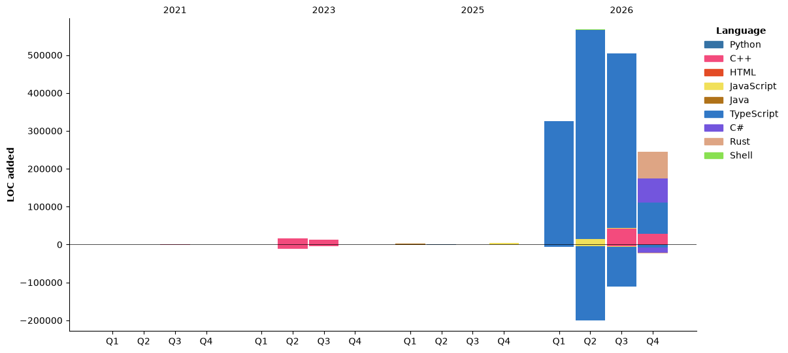

<div align="center">

[](https://git.io/typing-svg)

---

<p>Full-stack developer working on desktop software, self-hosted services, and developer tools.</p>

<p>
  <a href="https://github.com/cloudwhile">
    
  </a>
  <a href="https://cloudwhile.github.io">
    
  </a>
  <a href="mailto:cloudwhile@icetowne.com">
    
  </a>
</p>

</div>

## About me

- Building desktop applications that make system-level work easier to manage.
- Exploring self-hosted services and practical cloud-drive infrastructure.
- Creating reusable C/C++ libraries and modern web development tooling.
- Open to issues, ideas, and contributions across my public projects.

## Stack

<div align="center">
  <p><strong>Languages</strong></p>
  <a href="https://skillicons.dev">
    
  </a>
  <p><strong>Web</strong></p>
  <a href="https://skillicons.dev">
    
  </a>
  <p><strong>Tools and platforms</strong></p>
  <a href="https://skillicons.dev">
    
  </a>
</div>

## Activity

<div align="center">
  
</div>

<div align="center">
  <a href="https://github.com/cloudwhile">
    
  </a>
</div>

<details>
  <summary>WakaTime activity</summary>
  <br />

<!--START_SECTION:waka-->


**I'm a Night 🦉** 

```text
🌞 Morning                108 commits         ███░░░░░░░░░░░░░░░░░░░░░░   10.11 % 
🌆 Daytime                323 commits         ████████░░░░░░░░░░░░░░░░░   30.24 % 
🌃 Evening                494 commits         ████████████░░░░░░░░░░░░░   46.25 % 
🌙 Night                  143 commits         ███░░░░░░░░░░░░░░░░░░░░░░   13.39 % 
```
📅 **I'm Most Productive on Wednesday** 

```text
Monday                   100 commits         ██░░░░░░░░░░░░░░░░░░░░░░░   09.36 % 
Tuesday                  202 commits         █████░░░░░░░░░░░░░░░░░░░░   18.91 % 
Wednesday                219 commits         █████░░░░░░░░░░░░░░░░░░░░   20.51 % 
Thursday                 113 commits         ███░░░░░░░░░░░░░░░░░░░░░░   10.58 % 
Friday                   188 commits         ████░░░░░░░░░░░░░░░░░░░░░   17.60 % 
Saturday                 141 commits         ███░░░░░░░░░░░░░░░░░░░░░░   13.20 % 
Sunday                   105 commits         ██░░░░░░░░░░░░░░░░░░░░░░░   09.83 % 
```


📊 **This Week I Spent My Time On** 

```text
💬 Programming Languages: 
Other                    3 hrs 9 mins        ████████░░░░░░░░░░░░░░░░░   33.06 % 
Markdown                 2 hrs 10 mins       ██████░░░░░░░░░░░░░░░░░░░   22.68 % 
Python                   59 mins             ███░░░░░░░░░░░░░░░░░░░░░░   10.41 % 
TypeScript               57 mins             ██░░░░░░░░░░░░░░░░░░░░░░░   09.94 % 
Rust                     53 mins             ██░░░░░░░░░░░░░░░░░░░░░░░   09.28 % 
```

**I Mostly Code in C++** 

```text
C++                      5 repos             ██████░░░░░░░░░░░░░░░░░░░   25.00 % 
TypeScript               4 repos             █████░░░░░░░░░░░░░░░░░░░░   20.00 % 
C#                       3 repos             ████░░░░░░░░░░░░░░░░░░░░░   15.00 % 
Rust                     1 repo              █░░░░░░░░░░░░░░░░░░░░░░░░   05.00 % 
Shell                    1 repo              █░░░░░░░░░░░░░░░░░░░░░░░░   05.00 % 
```


**Timeline**




<!--END_SECTION:waka-->
</details>
